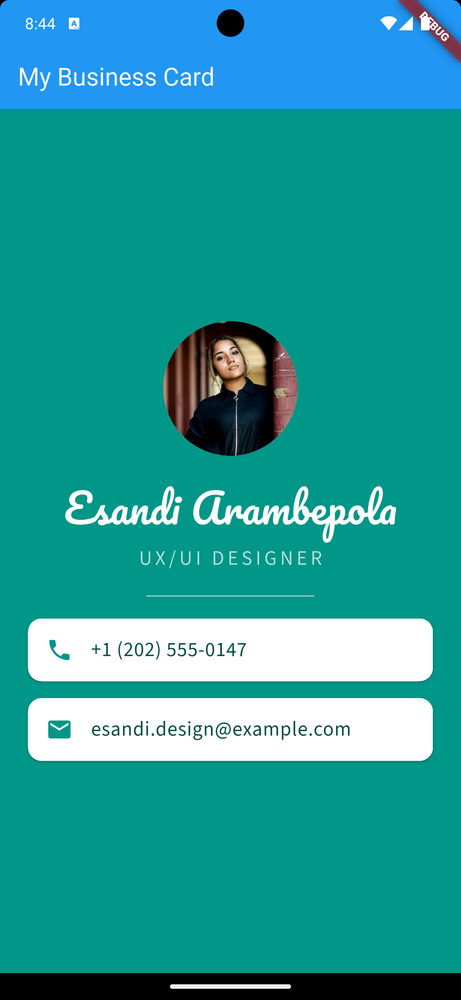

# Digital Business Card

A simple digital business card application developed using Flutter and Dart.

The application presents a personal profile with a photograph, name, professional title, and contact information in a clean, single-screen layout.

## Features

- Personal profile photograph displayed in a circular avatar.
- Custom fonts using Pacifico and Source Sans 3.
- Personal name and professional title.
- Phone number contact card.
- Email address contact card.
- Custom teal background and styled layout.

## App Screenshot



## Technologies Used

- **Flutter** – Cross-platform UI framework.
- **Dart** – Programming language.
- **Material Design** – UI components and layout.
- **Android Studio** – Development environment.

## Project Structure

```text
business_card/
├── assets/
│   ├── fonts/
│   │   ├── Pacifico-Regular.ttf
│   │   └── SourceSans3-Regular.ttf
│   └── images/
│       └── profile.jpg
├── lib/
│   └── main.dart
├── test/
│   └── widget_test.dart
├── pubspec.yaml
└── README.md
```

## Running the Application

1. Clone this repository.
2. Open the project in Android Studio.
3. Run the following command to install dependencies:

```bash
flutter pub get
```

4. Start an Android emulator or connect an Android device.
5. Run the application:

```bash
flutter run
```

## Running Tests

Run the widget test using:

```bash
flutter test
```

The test verifies that the business card displays the expected name, professional title, phone number, and email address.

## Author

**Esandi Arambepola**  
E298750